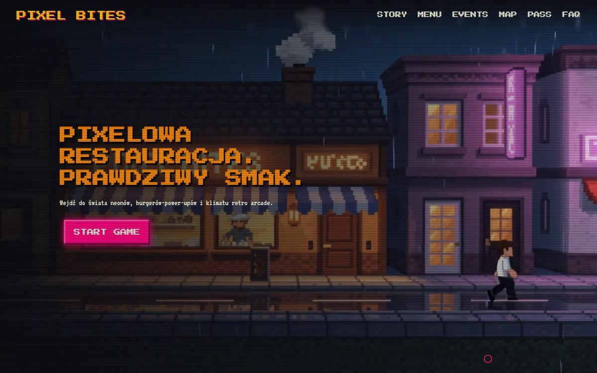
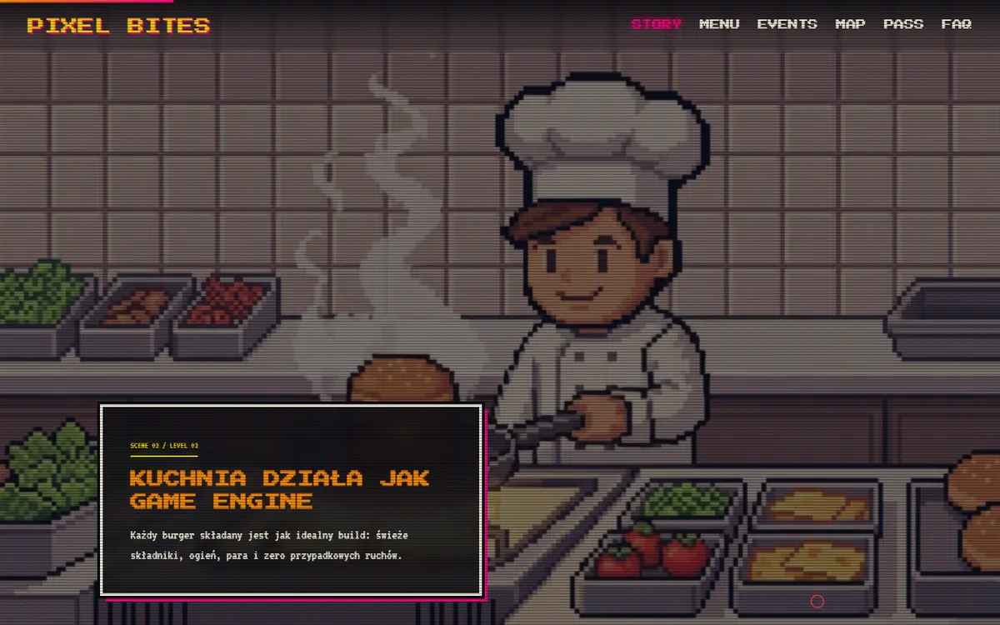
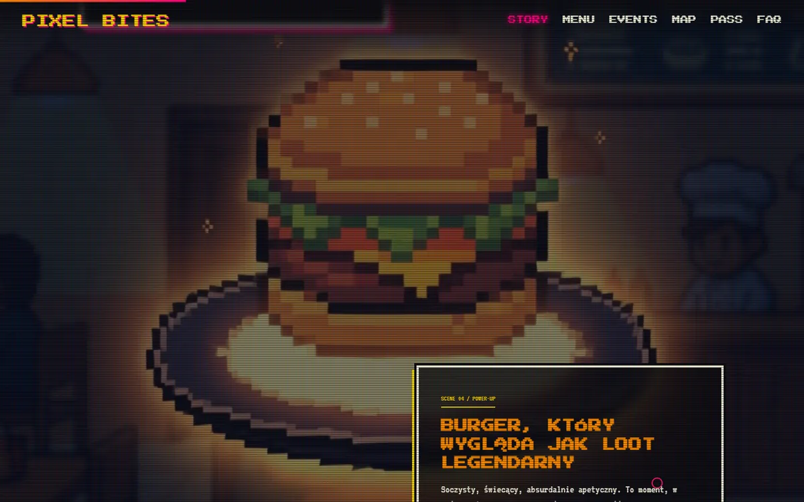
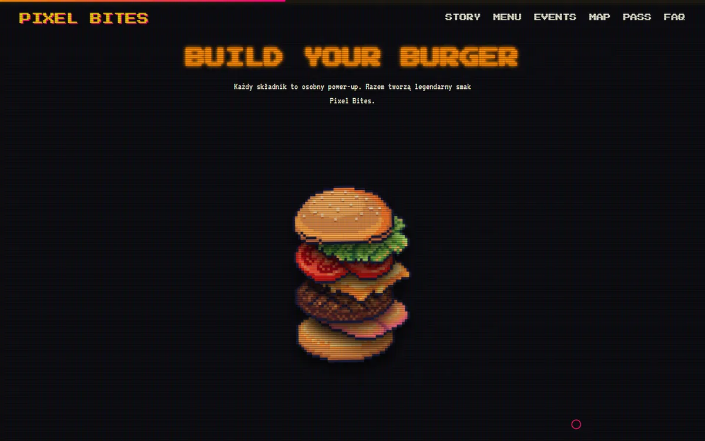
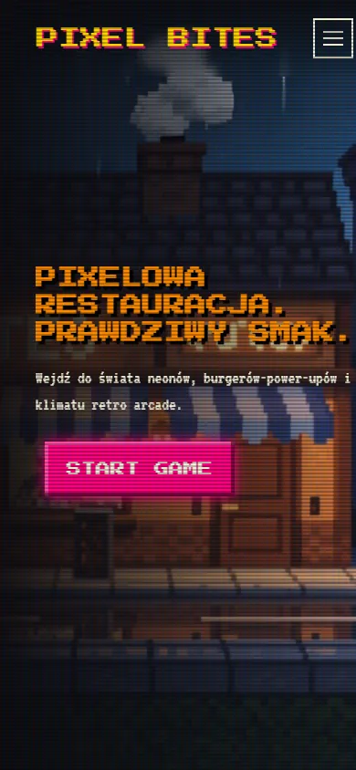
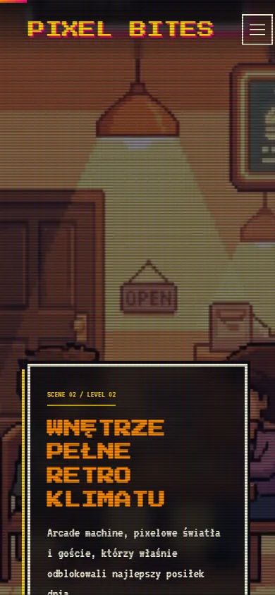
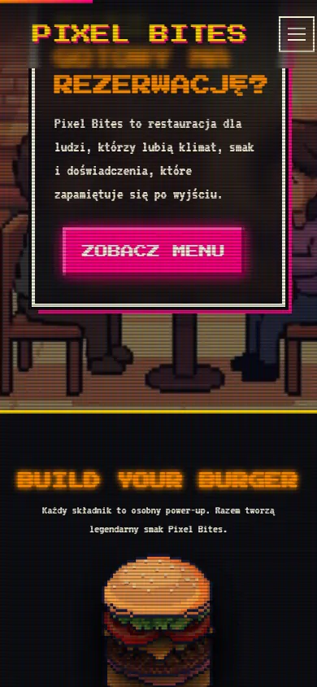

# Pixel Bites

**Strona restauracji w konwencji pixel-artowego automatu, z filmową prezentacją lokalu i burgerem rozkładanym na składniki podczas przewijania.**

**Strona: [pixel-bites-tawny.vercel.app](https://pixel-bites-tawny.vercel.app)**

Restauracja jest fikcyjna — dane lokalu i odnośniki społecznościowe są demonstracyjne.



## Po co to jest

Strona łączy ofertę burgerów z klimatem salonu gier. Przewijanie prowadzi przez
wnętrze, kuchnię i jedzenie, a menu pozwala przełączać prezentowane produkty.

- **Historia miejsca:** kolejne fragmenty opowieści przełączają filmy w przypiętej sekcji.
- **„Build your burger”:** warstwy burgera rozjeżdżają się na komputerze i odsłaniają opisy.
- **Menu „Power-up”:** wybór pozycji zmienia prezentację produktu; elementy korzystają z animacji.
- **Opinie, wydarzenia i lokalizacja:** sekcje uzupełniają prezentację restauracji.
- **Pixel Pass:** demonstracja programu lojalnościowego z paskiem doświadczenia i nagrodami.
- **FAQ i nawigacja:** rozwijane odpowiedzi, podświetlenie aktywnej sekcji i pasek postępu przewijania.

| **Kuchnia** | **Prezentacja burgera** |
|---|---|
|  |  |
| **Burger rozłożony na składniki** | |
|  | |

### Na telefonie

Burger jest statycznym stosem warstw z listą składników. Ta sekcja nie jest przypinana
do ekranu, a tło WebGL pozostaje wyłączone.

| **Start** | **Wnętrze** | **Składniki burgera** |
|---|---|---|
|  |  |  |

## Co jest w środku

**Front:** React 18, TypeScript i Vite. GSAP ze ScrollTriggerem steruje przewijanymi
scenami, Lenis odpowiada za płynne przewijanie, Three.js za tło WebGL,
a Framer Motion za animacje komponentów.

**Podział odpowiedzialności:** `App.tsx` składa sekcje, `useExperience` koordynuje
efekty imperatywne, a komponenty utrzymują własny stan, np. wybór pozycji menu.
Dane kontaktowe, nawigacja i odnośniki są wydzielone do `src/data/site.ts`.

### Po co było przepisywać

Projekt zaczął się jako jeden plik `pixelbites3.html` z bibliotekami ładowanymi z CDN.
Ta wersja przenosi go na React, TypeScript i Vite. Podzieliłem stronę na komponenty sekcji i wydzieliłem obsługę przewijania oraz scen
do hooka. Dzięki temu zmiana karty menu nie wymaga edycji tego samego pliku co
inicjalizacja WebGL. Biblioteki są zależnościami npm, a `package-lock.json`
zapisuje wersje użyte przy instalacji.

### Decyzje projektowe

**Efekty zależą od urządzenia i preferencji.** Hook przed inicjalizacją sprawdza:

```ts
const reducedMotion = window.matchMedia('(prefers-reduced-motion: reduce)').matches
const hasFinePointer = window.matchMedia('(pointer: fine)').matches
const isSmallScreen = window.innerWidth <= 768

const enableWebGL = !reducedMotion && hasFinePointer && !isSmallScreen
const enableCursor = hasFinePointer
```

WebGL uruchamia się na szerszym ekranie ze wskaźnikiem precyzyjnym, przy wyłączonym
ograniczeniu ruchu. Three.js jest importowany dynamicznie dopiero w tej gałęzi.
Własny kursor wymaga `pointer: fine`. Ograniczenie ruchu wyłącza Lenis,
magnetyczne przyciski i duże animacje wejścia.

**Jeden nasłuch ruchu dokumentu:** wspólnie aktualizuje pozycję kursora i paralaksę tła.
Magnetyczne przyciski mają dodatkowe, lokalne nasłuchy.

**Sprzątanie efektów:** AbortController usuwa nasłuchy podpięte do jego sygnału.
Hook odłącza też obserwator, usuwa funkcje z zegara GSAP, zwalnia zasoby Three.js,
cofa kontekst animacji i niszczy instancję Lenis.

**Świadomie bez StrictMode:** uzasadnienie w `src/main.tsx` dotyczy ponownej
inicjalizacji bibliotek imperatywnych w trybie deweloperskim. Sprzątanie pozostaje
w hooku i działa przy odmontowaniu.

**Osobny układ burgera na telefonie:** animowany rozkład warstw jest ograniczony
do większych ekranów. Przy ograniczeniu ruchu komputer pokazuje od razu układ docelowy.

**Zakres:** prezentacja restauracji z treścią w komponentach i danych lokalnych.
Pixel Pass przedstawia wygląd programu nagród; nie prowadzi kont klientów.

## Uruchomienie

```bash
npm install
npm run dev           # serwer deweloperski Vite
npm run build         # sprawdzenie TypeScript i build do dist/
npm run preview       # podgląd builda
npm run lint          # ESLint bez dopuszczonych ostrzeżeń
npm run format:check  # kontrola formatowania źródeł
```

## Struktura

```text
src/
  components/          sekcje strony, nawigacja, komunikat cookies i animacje
  hooks/
    useExperience.ts   GSAP, Lenis, WebGL, kursor, przewijanie i FAQ
  data/
    site.ts            kontakt, godziny, nawigacja i odnośniki
  index.css            style strony i układy responsywne
  App.tsx              składanie sekcji
  main.tsx             punkt wejścia
public/                filmy MP4, obrazy PNG, ikona i materiały do udostępniania
docs/zrzuty/           zrzuty na komputerze i telefonie
```

Licencja: MIT

---

Projekt i wykonanie: **Mikołaj Sitek** · [sitekmikolaj.pl](https://sitekmikolaj.pl) · [sitekmikolaj01@gmail.com](mailto:sitekmikolaj01@gmail.com)
